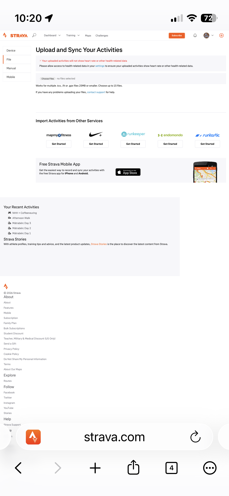
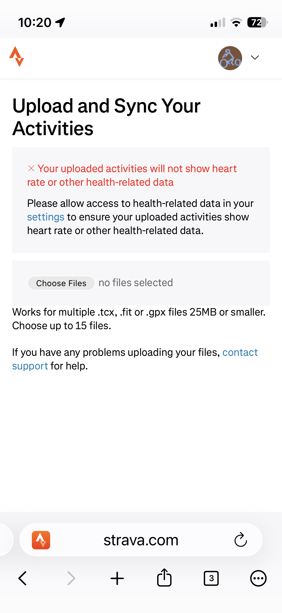

# Mobile Uploader for Strava

User script to make Strava's web uploader usable on mobile devices.

## Usage

### On iOS

- Install [Orion Browser](https://apps.apple.com/us/app/orion-browser-by-kagi/id1484498200)
- Add [Violentmonkey extension](https://violentmonkey.github.io/get-it/) to Orion Browser
- Install [this user script](https://github.com/salomvary/strava-mobile-upload/raw/refs/heads/main/strava-mobile-upload.js) in Violentmonkey (you can copy the URL and paste it into
  Violentmonkey's "Add script from URL" option)
- Profit.

### On Android

I don't have an Android phone. Contributions are welcome.

## Screenshots

### Before

### After

